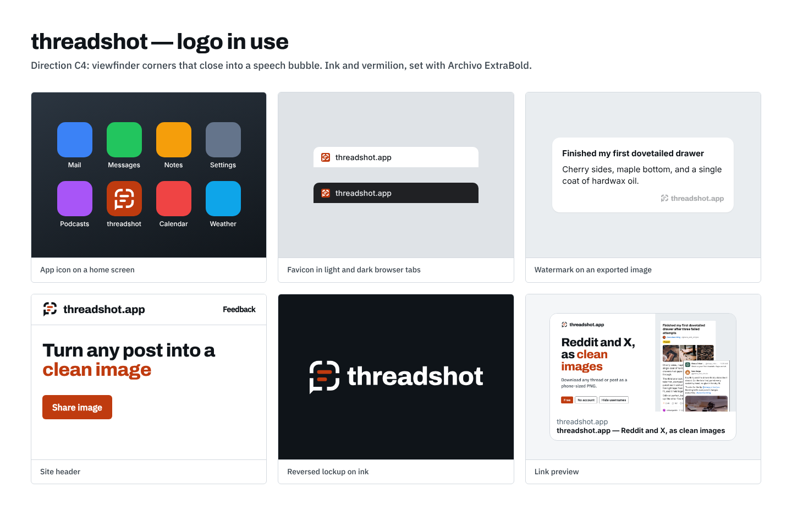

# threadshot logo

Viewfinder corners that close into a speech bubble, around two lines of text. A conversation, kept as a picture.



## Files

| Folder | What it holds |
| --- | --- |
| `svg/` | Masters. Every file is outlined paths only, with no fonts, rasters or filters. |
| `png/` | Transparent PNGs of each master: 1024px tall, and 512px for the icons. |
| `concepts/` | The exploration that led here. |
| `board.png` | The logo in use. |

Each mark comes in five colour schemes:

- **`color`**: ink frame and vermilion lines, for white or light backgrounds.
- **`reversed`**: white frame and vermilion lines, for ink.
- **`black`**: everything in ink.
- **`white`**: everything in white.
- **`vermilion`**: everything in vermilion.

The marks:

- **`symbol`**: the mark alone.
- **`symbol-small`**: a heavier cut for 32px and under.
- **`horizontal`**: the symbol with the wordmark beside it, the default lockup.
- **`stacked`**: the symbol above the wordmark.
- **`wordmark`**: the name alone.
- **`app-icon`**, **`app-icon-maskable`** and **`favicon`**: the mark in white on a vermilion tile.

## Rebuilding

The geometry lives in `scripts/logo/geometry.mjs`, which also draws the mark in the app (`src/components/LogoMark.svelte`). After changing it, run:

```sh
node scripts/logo/build.mjs      # SVG masters
node scripts/logo/board.mjs      # PNGs and board (needs Playwright)
node scripts/favicon/build.mjs   # public/ icons (needs Playwright)
```

The wordmark is Archivo ExtraBold at -0.02em tracking, outlined into `scripts/logo/wordmark.json` by `scripts/logo/outline-wordmark.cjs`. Archivo is under the SIL Open Font License, which allows its use in a logo.

## Construction

- **Grid:** a 256 grid. The frame has a 24-unit stroke and a 56-unit outer radius.
- **Gaps:** 32-unit gaps at the middle of each side.
- **Bubble corner:** the bottom-left corner is square and runs out into a 45° tail, 24 units long. This is the one detail that makes the frame a bubble, so keep it.
- **Lines:** 24-unit pills, 96 and 64 units long, set flush left.
- **Small cut:** a 36-unit stroke, 44-unit gaps and 32-unit lines, so it holds at 16px.

## Colour

| | HEX | RGB | Use |
| --- | --- | --- | --- |
| Ink | `#0f1419` | 15 20 25 | Frame, wordmark |
| Vermilion | `#bf3b0f` | 191 59 15 | Lines, app icon tile |
| White | `#ffffff` | 255 255 255 | Backgrounds, reversed marks |

These match `--color-ink` and `--color-accent` in `src/styles/global.css`.

Contrast ratios:

- **Vermilion on white:** 5.5:1.
- **Ink on white:** 18.5:1.
- **Vermilion on ink:** 3.4:1. That's fine for the lines of the reversed mark, but too low for small text.

Print colour codes (CMYK and Pantone) still need matching by a printer.

## Clear space and minimum size

- **Clear space:** leave at least the frame's stroke width doubled (48 units at 256) on every side, measured from the frame and tail.
- **Symbol:** 16px minimum, using `symbol-small` at 32px and under.
- **Horizontal lockup:** 96px wide minimum. Below that, use the symbol alone.
- **Print:** 6mm for the symbol and 20mm for the horizontal lockup.

## Don't

- Round the bottom-left corner, or move the tail to another corner.
- Close the gaps in the frame, or change the number of lines.
- Recolour the lines with anything but vermilion, or use the full-colour mark on vermilion. Use `white` there.
- Stretch, rotate, outline or add effects such as shadows or gradients.
- Set "threadshot" in another typeface, or re-space the outlined wordmark.
- Put the colour mark on busy photos. Use `white` or `black` on a calm area instead.

## In the app

- **Header:** the small symbol beside "threadshot.app" (`src/layouts/Base.astro`).
- **Watermark:** a one-colour small symbol, at the watermark's faint opacity (`src/components/thread/Watermark.svelte`).
- **Icons:** the favicon, app icons and social preview in `public/`.

## Open items

- A professional trademark search; this kit can't clear the mark.
- CMYK and Pantone matches for print.
